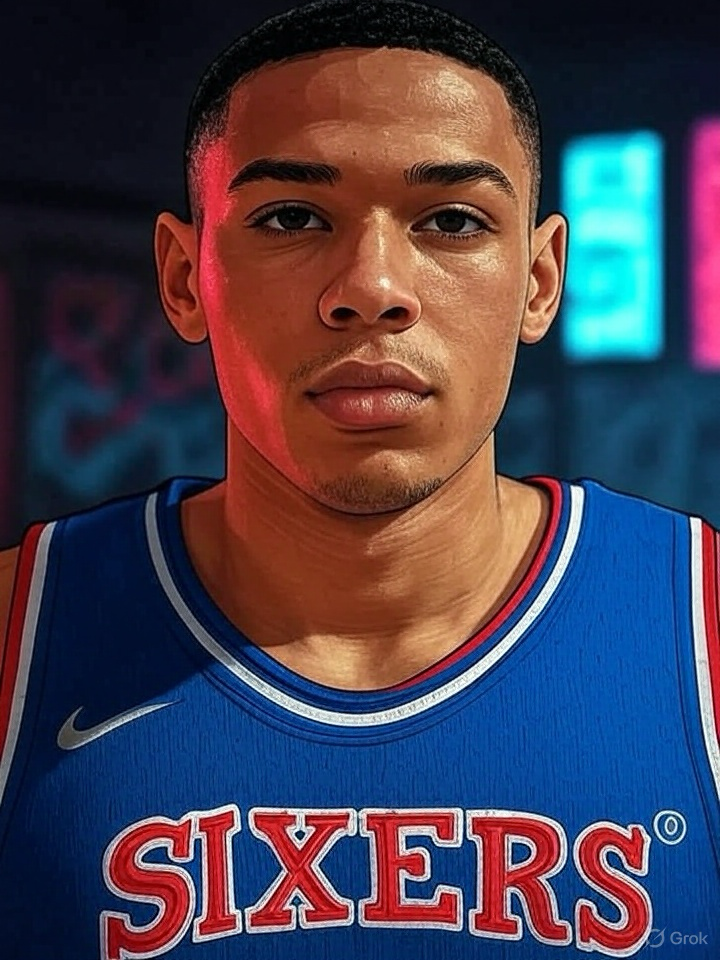
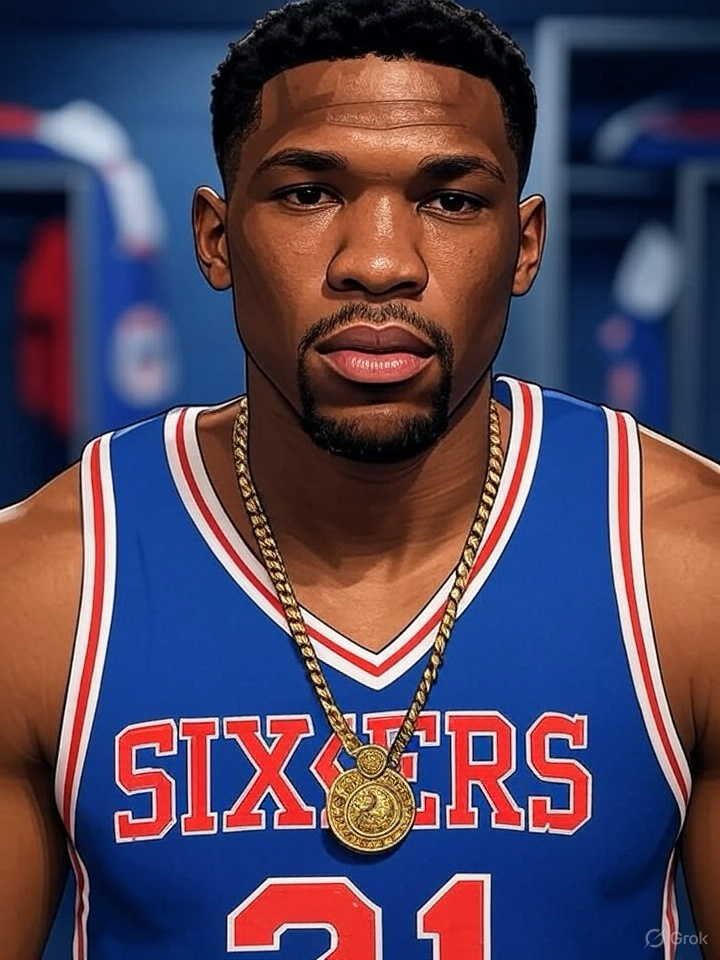
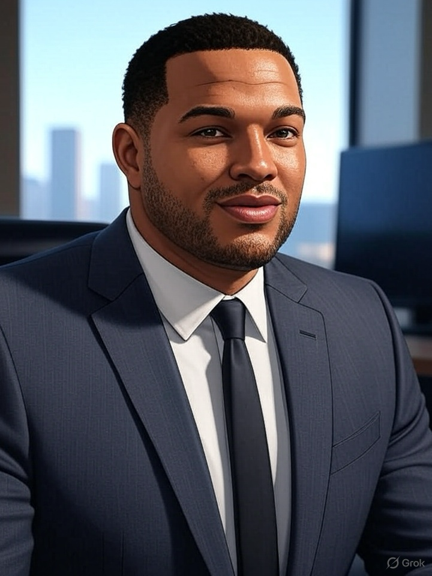
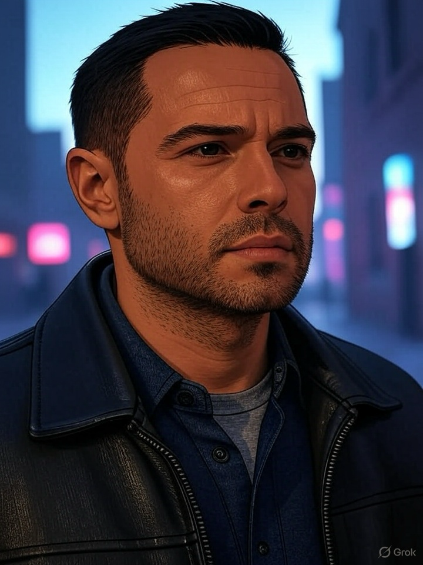
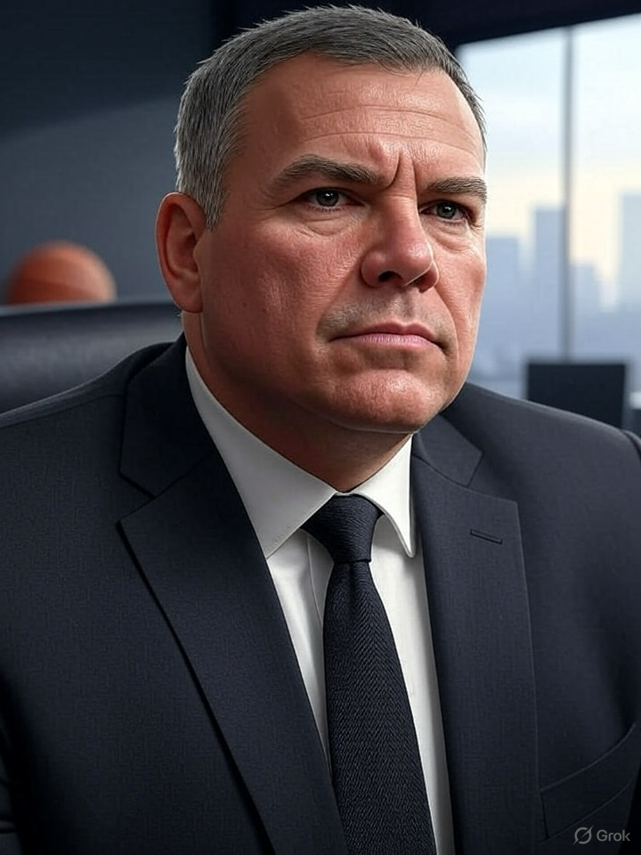

# Personnages

 
**Caleb Moore** — Rookie des Philadelphia Sixers, témoin indirect du drame au parking VIP.

 
**Kashen Reed « KASH »** — Star NBA des Sixers, impliqué dans la bagarre qui déclenche l'affaire.

 
**Damon Devine** — Agent NBA influent, représente Kashen et Caleb.

 
**Dana Cole** — Journaliste indépendante (@DCole), mène sa propre enquête sur l'affaire.

 
**Lennox Foster** — Inspecteur de police chargé de l'enquête sur le meurtre du parking VIP.

 
**Malcolm Reese** — Propriétaire du Wells Fargo Center, impliqué dans l'enquête et l'organisation du concert.

 
**Tré Johnson** — Rappeur très célèbre de Philadelphie, victime de la bagarre au parking, décédé.
